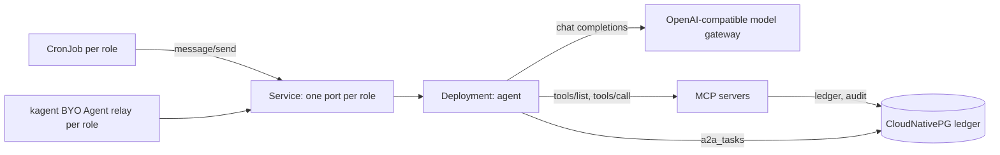

# accountant-agent

## Purpose

Runs an A2A accounting agent (image `images/accountant-agent`, official `a2a-sdk`, A2A
v0.3 JSON-RPC) with two roles, a ledger database and the schedules that start its work.
Everything installs into the release namespace; the chart renders no cluster-scoped
object.



- **Roles.** `bookkeeper` (daily, `0 6 * * *`) collects new purchase invoices and bank
  lines and drafts bookings; `cfo` (weekly, `0 7 * * 1`) writes a read-only overview. Each
  role has its own port, agent card (`<agentName>-<role>`), instructions, tool filter,
  CronJob and kagent Agent. A role is switched off with `roles.<role>.enabled: false`;
  another role is one more key under `roles`.
- **Agent.** One Deployment serves every role. The agent card is at
  `/.well-known/agent.json` and `/.well-known/agent-card.json` of the role's port; the
  JSON-RPC endpoint is `/`. `/readyz` fails while `model.baseUrl` is empty or the task store
  database does not answer.
- **Model.** `model.baseUrl` is an OpenAI-compatible endpoint up to `/v1`. The bearer token
  is a projected ServiceAccount token with audience `model.tokenAudience` (default: the host
  of `model.baseUrl`), read from file on every call, so no key is stored. A gateway that
  needs a key instead takes `model.apiKeySecret`.
- **Tools.** kagent 0.x gives a BYO agent no MCP binding, so the agent lists the tools of
  every server in `mcpServers` itself and offers them as `<name>__<tool>`; again after
  `toolCacheSeconds`. A server with `tokenAudience` gets a ServiceAccount token with that
  audience as bearer.
- **Approvals.** The agent books nothing on its own. When a tool answers with
  `approvalRequired: true` and a `draftId`, or the model calls the built-in tool
  `request_approval`, the task stops in state `input-required`. Its status message holds a
  short draft summary and the two answers, `boek <id>` and `afkeuren <id> <reason>`
  (`approval.approveCommand`, `approval.rejectCommand`), plus a data part per draft. The
  front-end that relays the task to a person, on any channel, sends the answer back as a new
  message on the same task; the MCP server that commits the draft checks the approval.
- **kagent.** With the `kagent.dev/v1alpha2` API present and `kagent.enabled`, each role is
  a BYO Agent `<release>-<role>`. kagent runs its pod on port 8080; that pod runs
  `accountant_agent.relay` to the role's port. Card through kagent:
  `/api/a2a/<namespace>/<release>-<role>/.well-known/agent.json`.
- **Schedules.** CronJob `<release>-<role>` posts `roles.<role>.task` as a non-blocking A2A
  task and exits; the task runs on in the agent.
- **Ledger.** With `ledger.enabled`, a CloudNativePG Cluster `<release>-ledger` with
  database `ledger.database`, owned by `ledger.owner`. At creation it gets the tables
  `ledger` (drafted, approved and booked entries), `audit` (append-only trail) and
  `documents` (source documents). Every row carries `retain_until`, `ledger.retentionYears`
  (default and minimum 7, the Dutch fiscal retention period) after it is written; a trigger
  refuses to delete a row before that date or to shorten it, and the audit table refuses
  every update and delete. The tables belong to the database superuser; the application user
  may read and insert, and change ledger and documents rows. The MCP server that writes
  bookings writes `ledger` and `audit` with the URL in Secret `ledger.urlSecret` (default
  `<release>-ledger-app`, key `uri`, made by CloudNativePG). The agent keeps its A2A tasks in
  table `a2a_tasks` of the same database (`taskStore.type: database`), so a task waiting for
  approval survives a restart.
- **Network.** NetworkPolicies admit the agent ports and the database port from pods of the
  release namespace only, and the operator's status port from
  `ledger.operatorNamespaceSelector`. `networkPolicy.namespaceSelector` admits more
  namespaces to the agent ports.

## Install

```bash
helm repo add grncloud https://apps.openshift.eu
helm install books grncloud/accountant-agent \
  --set model.baseUrl=https://llm.example.com/v1 \
  --set model.name=my-model \
  --set 'mcpServers[0].name=ledger' \
  --set 'mcpServers[0].url=http://ledger-mcp:8080/mcp' \
  --set 'mcpServers[0].tokenAudience=ledger-mcp'
```

- `image.repository`, `image.tag`, `image.digest` (default `ghcr.io/<owner>/accountant-agent`,
  `0.1.0`, empty): the agent, the relay and the CronJob task.
- `agentName` (default: the release name): prefix of the agent card names.
- `model.baseUrl`, `model.name`, `model.tokenAudience`, `model.apiKeySecret.{name,key}`,
  `model.temperature` (0), `model.maxToolRounds` (20), `model.timeout` (300 seconds).
- `mcpServers` (default empty): `{name, url, tokenAudience}` per server.
- `toolCacheSeconds` (300).
- `approval.approveCommand`, `approval.rejectCommand` (`boek`, `afkeuren`).
- `roles.<role>.{enabled, port, description, schedule, task, tools, instructions}`; a role
  name is a DNS label of at most 15 characters.
- `cronJob.enabled` (true), `cronJob.timeZone` (empty: the cluster's), `cronJob.resources`.
- `kagent.enabled` (true), `kagent.resources`: the relay pods.
- `taskStore.type` (`database`; `memory` loses tasks on restart).
- `ledger.enabled` (true), `ledger.urlSecret.{name,key}`, `ledger.database`, `ledger.owner`
  (`ledger`), `ledger.retentionYears` (7), `ledger.instances` (1), `ledger.imageName`,
  `ledger.storage.{size,storageClass}` (`5Gi`, default class), `ledger.resources`,
  `ledger.operatorNamespaceSelector`. The schema runs once, when the Cluster is created.
- `networkPolicy.enabled` (true), `networkPolicy.namespaceSelector` (empty).
- `resources`, `logLevel` (`INFO`), `nodeSelector`, `tolerations`, `affinity`.

## How to login

The agent has no user interface and no login. People reach it through an A2A client, such
as the kagent UI of the namespace (`<release>-<role>`) or an assistant agent that relays its
approvals. The A2A ports admit only pods of the release namespace (and
`networkPolicy.namespaceSelector`); the model and MCP servers see the agent's ServiceAccount
`<release>` as caller. The database credentials are the CloudNativePG Secrets
`<release>-ledger-app` (application user) and `<release>-ledger-superuser` when enabled.

## Delivery instructions

- Readiness: `oc get deploy <release>`; `oc logs deploy/<release>` names the roles, their
  ports, the task store and the number of MCP tools found.
- Agent card of a role: `oc exec deploy/<release> -- python3 -c "import urllib.request;
  print(urllib.request.urlopen('http://127.0.0.1:8081/.well-known/agent.json').read().decode())"`.
- Start a role's run now: `oc create job --from=cronjob/<release>-bookkeeper run-now`.
- Tasks waiting for approval:
  `oc exec <release>-ledger-1 -- psql ledger -c "select id, status->>'state' from a2a_tasks where status->>'state' = 'input-required'"`.
- Database URL for the MCP server that writes ledger and audit: Secret
  `<release>-ledger-app`, key `uri` (or `ledger.urlSecret`).
- Backups of the ledger: the retention period needs them. Configure a CloudNativePG backup
  (barman-cloud plugin) for `<release>-ledger` with a retention of at least
  `ledger.retentionYears`; restore by bootstrapping a new Cluster from that backup and
  pointing `ledger.urlSecret.name` at its `-app` Secret.
