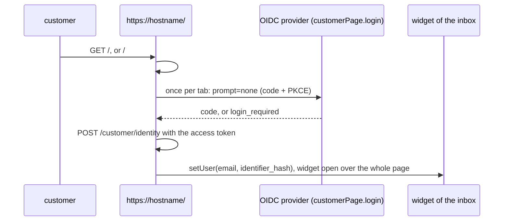
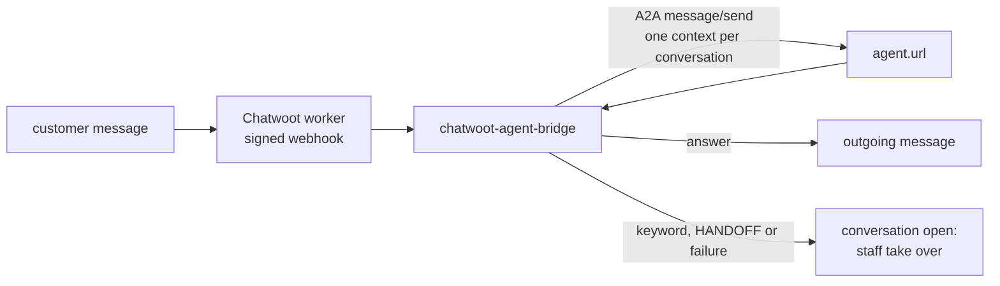
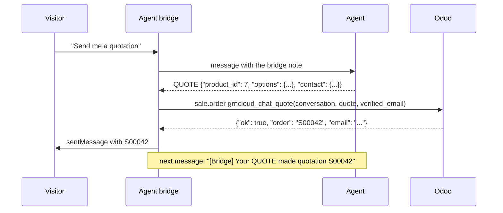
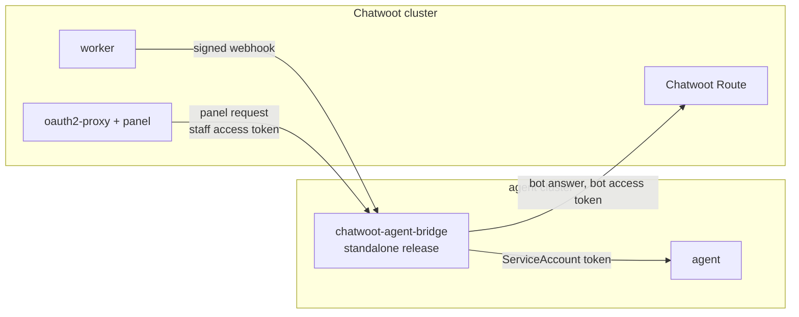
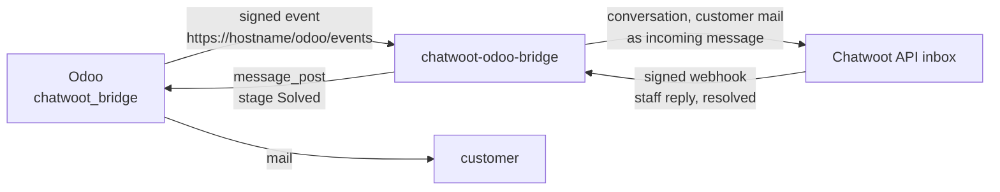

# Chatwoot

## Purpose

Chatwoot Community Edition: one screen for customer conversations, with the live chat
widget for a website and API channel inboxes that other systems fill, such as the Odoo
bridge for helpdesk tickets and CRM leads. The chart runs the
upstream Community Edition image (no enterprise code) with a PostgreSQL database with
pgvector from the CloudNativePG operator, a Valkey store on a volume, and attachments on a
volume or in an object bucket. With single sign-on, staff log in at an OIDC provider and
never use a Chatwoot password.

## Install

    helm repo add grncloud https://apps.openshift.eu
    helm install chatwoot grncloud/chatwoot

Install one release per project. The first start takes a few minutes: the database is
created, a Job migrates it and creates the account and its super admin, and web and
worker start only after that Job closed the onboarding page. There is no signup and no
onboarding page. `helm install --wait` works; give it `--timeout 15m` for the first start.

    oc get route chatwoot -o jsonpath='https://{.spec.host}{"\n"}'
    oc get secret chatwoot-credentials -o jsonpath='{.data.super-admin-password}' | base64 -d

The super admin is the break-glass account `superadmin@chatwoot.invalid` (value
`account.adminEmail`, always under the reserved domain `.invalid`), with the password
above. Without single sign-on it logs in at `/app/login` and invites the staff. With
single sign-on it logs in at `/super_admin` only: no login at the OIDC provider can become
a super admin.

| Value | Default | Meaning |
|---|---|---|
| `route.hostname` | empty | Hostname. Empty: OpenShift assigns one and the pods read it from the Route. |
| `account.name` | `Support` | Name of the account the first install creates. |
| `account.adminEmail` | empty | Break-glass super admin, an address under `.invalid`. Empty: `superadmin@chatwoot.invalid`. |
| `attachments.storage` | `volume` | `volume`: a ReadWriteOnce volume, web and worker on one node, one web pod. `objectBucketClaim`: a bucket, any number of web pods. |
| `attachments.objectBucketClaim.storageClassName` | empty | Storage class of the bucket claim; required with `objectBucketClaim`. |
| `database.instances` | `1` | PostgreSQL instances. `2` adds a standby. |
| `database.imageName` | CloudNativePG `17.11-standard-trixie` | PostgreSQL image; it must carry pgvector. |
| `web.replicas`, `worker.replicas` | `1` | Pods of the web server and of the background worker. |
| `sso.enabled` | `false` | Staff log in at an OIDC provider through oauth2-proxy and the login bridge. |
| `sso.issuerUrl` | empty | OIDC issuer; required with `sso.enabled`. |
| `sso.clientId` | empty | OIDC client. Empty: the Route host. |
| `sso.allowedGroups` | empty | Groups (claim `sso.groupsClaim`) that may log in. Empty: every user of the issuer. |
| `sso.deniedEmails` | empty | Addresses that never get a Chatwoot login, such as shared accounts of the issuer. Exact address, any case. It refuses new logins only: delete an existing Chatwoot user of the address first. |
| `sso.adminGroups` | empty | Groups whose members are account administrators, others agents. Empty: new users are agents and roles set in Chatwoot stay. |
| `sso.session.refresh` | `5m` | oauth2-proxy checks the user's groups at the OIDC provider again this often. |
| `sso.session.expire` | `12h` | An oauth2-proxy session ends after this. |
| `sso.session.chatwootHours` | `36` | A Chatwoot dashboard session ends after this many hours; 25 to 720. The dashboard keeps its session cookie for whole days rounded down, so a shorter value would end every session at once; the chart refuses it. |
| `sso.public.widget` | `true` | The live chat widget is reachable without a login. |
| `sso.public.inboxApi`, `.surveys`, `.helpCenter` | `false` | Further paths without a login. |
| `sso.public.customerPage.enabled` | `false` | `/` of the host is a page for customers: a full-window chat of the Website inbox `sso.public.customerPage.inbox`, a link to `portalUrl` and a staff sign-in link to `/app/login`. Off: `/` is the staff login. |
| `sso.public.customerPage.login.issuerUrl`, `.clientId` | empty | The customer login on that page, an OIDC public client with PKCE. Empty: no login. |
| `networkPolicy.webIngressFrom` | empty | Further peers that may reach Chatwoot web on port 3000. |
| `networkPolicy.agentEgress.to` | empty | Peers the agent bridge may reach besides Chatwoot and DNS: the agent and its token endpoint. Empty: any public address on `networkPolicy.agentEgress.ports` (`443`), plus the namespace of an `agent.url` that names a Service of this cluster. |
| `networkPolicy.dnsPeers` | namespace `openshift-dns` | Peers of the cluster DNS that the agent bridge asks. |
| `secrets.type` | `kubernetes` | `externalSecret` reads the secrets from a secret store. |
| `extraEnv` | empty | Further Chatwoot settings, for example the `SMTP_*` variables. |
| `agent.url` | empty | JSON-RPC address of the A2A agent of the bot, the panel and the drafts; required with any of them. |
| `agent.auth.type` | `none` | `serviceAccountToken`: a token of ServiceAccount `chatwoot-agent-bridge` for `agent.auth.audience`. `clientAssertion`: that token as client assertion at `agent.auth.tokenUrl` for `agent.auth.clientId`. `clientSecret`: the client secret `secrets.agentClientSecret` at `agent.auth.tokenUrl` for `agent.auth.clientId`. |
| `agentBot.enabled` | `false` | An Agent Bot answers customers through the agent until a person takes over. |
| `agentBot.inboxes` | empty | Inbox names the bot answers in; `*` is every inbox. |
| `agentBot.agentUrl` | empty | A2A address of the bot's own agent, with `agent.auth`. Empty: `agent.url`. |
| `odoo.website.identity.enabled` | `false` | Identity validation on the Website inbox: only a contact the site signed with `secrets.websiteIdentityKey` counts as a logged-in customer. |
| `odoo.website.identity.records` | `true` | The bot's agent gets a logged-in customer's own Odoo records and profile, read by the bridge. |
| `odoo.website.preChatMessage` | empty | Markdown message above the pre-chat form, set by the prepare Job. Empty: the message set in Chatwoot stays. |
| `agentBot.handoff.keywords` | `human`, `person`, `agent`, `staff` | A customer message that is exactly one of these hands the conversation to a person. |
| `copilotPanel.enabled` | `false` | A panel in the conversation sidebar where staff ask the agent; needs `sso.enabled`. |
| `draftAgent.enabled` | `false` | The agent drafts a reply to each customer message as a private note for staff. |
| `draftAgent.inboxes` | empty | Inbox names whose customer messages get a draft; `*` is every inbox. Required with `draftAgent.enabled`. |
| `agentBridge.remoteUrl` | empty | https address of a standalone bridge elsewhere. Empty: the bridge runs in this release. |
| `odoo.enabled` | `false` | Odoo tickets and leads become conversations; staff replies go back to Odoo as mail. Needs `route.hostname`, `odoo.url` and `secrets.odooApiKey`. |
| `odoo.url`, `odoo.database` | empty | https address of Odoo, and its database (empty: the server's only database). |
| `odoo.ticketInbox`, `odoo.leadInbox` | `Support`, `Sales` | API inboxes of tickets and of leads. An empty `leadInbox` mirrors no leads. |
| `odoo.solvedStage` | `Solved` | Stage a ticket moves to when its conversation is resolved. |
| `odoo.website.enabled` | `false` | Website inbox `odoo.website.inbox` (`Website`) for the widget on `odoo.website.url`; each chat becomes an Odoo ticket. |
| `odoo.website.team` | empty | Helpdesk team of chat tickets; empty: Odoo's default team. |
| `odoo.website.ticketsPerEmail`, `odoo.website.ticketsPerHour` | `3`, `20` | New chat tickets per address in 24 hours, and in all in one hour. |
| `odoo.website.visitorPartner` | `Website visitor` | Odoo partner of every chat ticket whose visitor the website did not verify. |
| `odoo.website.conversationsPerMinute` | `5` | New widget conversations per client address in one minute (Chatwoot's `RATE_LIMIT_WIDGET_CONVERSATIONS`). |
| `odoo.website.salesLabel`, `odoo.website.cancelledStage` | `sales`, `Cancelled` | The label that moves a chat to a new lead, and the stage its ticket moves to. Must not be a triage label. Empty label: chats stay tickets. |
| `odoo.sales.fromSupport` | `false` | The sales label also moves a conversation of `odoo.ticketInbox` to a new lead with a conversation in `odoo.leadInbox`. Needs `leadInbox` and a sales label. |
| `odoo.sales.team` | empty | CRM team of the leads the sales label makes; empty: Odoo's default team. |
| `odoo.panel.enabled` | `false` | Odoo panel in the conversation sidebar (Dashboard App `odoo.panel.title`, `Odoo`). Needs `sso.enabled`. |
| `odoo.panel.issues.url`, `odoo.panel.issues.user` | empty | Jira site whose issue status the panel shows for the keys in `x_jira_key`, and the account email for Jira Cloud (empty: a personal access token). The token is `secrets.issueTrackerToken`. |
| `monitoring.enabled` | `false` | A ServiceMonitor of the Odoo bridge; `monitoring.namespaceLabels` names the namespaces that may scrape it. |
| `monitoring.alerts` | `true` | Alert rules of the Odoo bridge next to the ServiceMonitor; false where the platform alerts centrally. |
| `agentBridge.standalone.enabled` | `false` | A release of the bridge alone, next to the agent; needs `standalone.chatwootUrl`, and for the panel `standalone.staff.issuerUrl` and `standalone.staff.clientIds`. |

### Single sign-on

With `sso.enabled` the Route points at oauth2-proxy. Every path needs a login at the OIDC
provider, except the ones the widget needs: `/packs/js/sdk.js`, `/widget`, `/vite/assets/`,
`/api/v1/widget/`, `/cable`, the sounds under `/audio/` and images under `/assets/images/`,
and reading attachments under
`/rails/active_storage/`. The dashboard's login page goes to the login bridge in the
oauth2-proxy pod, which listens on 127.0.0.1 only. It finds or creates the Chatwoot user
of the logged-in email through the Platform API, puts it in the account, and sends the
browser to that user's one-time login link (valid five minutes, usable once). Users get a
random Chatwoot password that nobody learns. The Platform App and its token are made by
the Job; the token is in Secret `chatwoot-platform`, which only the bridge and the Job
mount.

The OIDC client needs the redirect URI `https://<hostname>/oauth2/callback` and a secret
equal to key `client-secret` of Secret `chatwoot-oauth`. Its client id is the hostname
unless `sso.clientId` is set. The bridge never logs in an address under `.invalid` or a
super admin: Chatwoot's Platform API refuses those in this chart.

### Customer page

With `sso.public.customerPage.enabled`, `GET /` of the host is a page for customers instead
of the staff login. Chatwoot web serves it (`customer_page.rb`); staff sign in at
`/app/login`, linked from the page.



- The page is the widget of the Website inbox `sso.public.customerPage.inbox`, open over the
  whole page below a bar with the title, the login, a link to `portalUrl` (`portalText`)
  and "Staff sign-in". While the inbox does not exist, `/` stays the staff login.
- `https://<hostname>/#cw=<token>` continues the conversation of that token: a site that
  embeds the widget opens it with the value of its `cw_conversation` cookie for a bigger
  window. The token travels in the fragment, which no server log records; whoever holds
  the link continues that conversation, as with Chatwoot's own popout.
- With `login.issuerUrl` and `login.clientId` a customer logs in on the page: the browser
  signs in at the provider with authorization code and PKCE, and posts the access token
  once to `POST /customer/identity`. Chatwoot web checks the token at the provider's
  userinfo endpoint, requires that client and a verified email, and answers with
  `HMAC-SHA256` of the email under the inbox's identity validation key, which never leaves
  the server. A visitor with a session at the provider is logged in without a click, once
  per browser tab; `/?chat-login=1` starts the login at once. The client is public, with
  redirect URI `https://<hostname>/` and web origin `https://<hostname>`.
- Paths without a login besides the widget's: `GET /` and `POST /customer/identity`.
- A site that draws its own controls over the widget header checks them on every Chatwoot
  upgrade: a screenshot of the open widget at desktop and phone width, on the pre-chat form
  and in a conversation.

### When a user leaves the allowed group

| Access | Ends |
|---|---|
| Dashboard and API through the Route | at the next session refresh, within `sso.session.refresh` |
| A Chatwoot session token used from inside the cluster, past oauth2-proxy | when it expires, within `sso.session.chatwootHours` |
| Live updates over `/cable`, which is public for the widget | only when the user is removed from the account |
| Membership of the account | only by hand |

The bridge sees logins only, so it cannot notice that a user left a group. Delete the
user when they leave: Settings, Agents, delete. That removes them from the account and,
when they are in no other account, deletes the user with all its sessions. Then restart
the web pods (`oc rollout restart deployment/chatwoot-web`), which ends their open live
update connection.

### Message signature

With `signature.text`, the prepare Job gives every staff user without a signature that
Markdown text as their Chatwoot message signature, `{name}` replaced by their display name,
else their name (a name that is an address becomes its local part: `s.terburg` is
`S. Terburg`). It switches the signature on in the reply editor for the channel types of
`signature.channels` (default `Channel::Api`, the Odoo inboxes), unless the user switched it
off there. A signature a user wrote or cleared stays. A staff user appears at the first login and is
signed at the next install or upgrade. The service users of the chart get none.

The Odoo bridge renders the Markdown of a staff reply (not of a contact's message) into
the Odoo mail: bold, italic,
`https` and `mailto` links, `https` images (64 pixels high) and a backslash at the end of a
line as a line break. Anything else stays escaped text.

### Network

The chart's NetworkPolicies admit the paths between its own components, but they add to
the platform's policies and cannot narrow them. A platform policy that admits every pod of
the same tenant, or of the same project, still reaches Chatwoot web on port 3000, the store
on port 6379 and oauth2-proxy on port 4180 directly. Such a pod meets Chatwoot's own
password logins (`/auth/sign_in`, `/super_admin`), never the single sign-on; every password
is random and unknown. The login bridge has no network port at all, so no pod can send it
an identity header.

### Mail

Chatwoot sends no mail unless `extraEnv` sets `SMTP_ADDRESS` and the other `SMTP_*`
variables. Without them password reset and notification mails are switched off.

### Agent Bot

With `agentBot.enabled` an A2A agent answers customers. The prepare Job creates the Agent
Bot `agentBot.name` on every install and upgrade, with the access token and webhook secret
of Secret `chatwoot-agent-bot` (only the Job and the bridge mount it), and connects it to
exactly the inboxes of `agentBot.inboxes`; an inbox created later is connected on the next
upgrade. A conversation in such an inbox starts as pending, held by the bot:



- The bridge refuses a webhook without a valid `X-Chatwoot-Signature`, and only the worker
  pods reach it.
- An answer that holds `agentBot.handoff.marker` as a word of its own, anywhere in the
  text (`HANDOFF`, `I'll pass you on. HANDOFF`), hands off: the customer gets
  `agentBot.handoff.message`, never the rest of that answer. `HANDOFFS` or `handoff` is
  text.
- The first message of a conversation carries `agentBot.instructions`; the A2A context id is
  kept in the conversation's custom attribute `a2a_context_id`, so later messages continue it.
  The bot signs that value for the conversation with its webhook secret: the widget API
  lets a visitor write any custom attribute, and a value the bot did not sign for this
  conversation starts a new context instead of continuing someone else's.
- Chatwoot refuses webhooks to private addresses. The chart initializer of web and worker
  allows a private address for the bridge Service alone.
- Once a conversation is open the bot stays silent in it, until staff set it back to
  pending. While the bot holds a conversation, it gets no AI draft and no triage.
- `agentBot.agentUrl` gives the bot an agent of its own; the drafts, the triage and the
  panel keep `agent.url`.

#### Logged-in customers

Every message the bot passes on starts with a note of the bridge on who writes. With
`odoo.website.identity.enabled` the Website inbox requires Chatwoot identity validation,
and a visitor counts as a logged-in customer only when Chatwoot verified the contact of that
conversation (`hmac_verified`): the site signed the contact's identifier, the customer's
email, with `HMAC-SHA256(secrets.websiteIdentityKey, email)` and passed it to the widget:

```js
window.$chatwoot.setUser(email, { email: email, name: name, identifier_hash: hash });
```

- Any other visitor is not logged in, whatever address they type in the pre-chat form or
  the chat: the agent gets no name, no email and no record of them.
- With `odoo.website.identity.records` the note of a logged-in customer holds that
  customer's own partner (the one company whose contact has exactly that email), sale
  orders, subscriptions and helpdesk tickets, read by the bridge with `secrets.odooApiKey`
  from its own Secret `chatwoot-agent-odoo`. An address of several companies shows no
  record.
- The note also holds the profile a quotation needs: the contact's name and phone, the
  company's name and VAT, and the invoice address (the company's invoice contact, else the
  company's own address), then `missing: <fields>` for what Odoo lacks. A phone or company
  the site passed to `setUser` fills a gap only, marked as from the login profile; Odoo's
  values win. The agent reads nothing from Odoo itself, so a customer cannot steer it to
  another customer's records. Add Odoo's address to `networkPolicy.agentEgress`.
- The key reaches only the prepare Job (Secret `chatwoot-website-identity`), which sets it as
  the inbox's identity validation key. Compute the hash on the site's server, never in the
  browser.

#### Quotations

With `agentBot.quotations.enabled` (needs `odoo.website.identity.records`) the agent can
make a quotation. The bridge calls Odoo method `sale.order` `grncloud_chat_quote`, part of
this chart's contract: Odoo needs a module that provides it (`grncloud_chat_order` of
GRN.CLOUD does), and the bridge's Odoo user needs the right to call it.



- An answer that holds `<marker> {json}` (the marker as a word, then the object, which may
  span lines) never reaches the visitor, none of it. The marker without `{` is plain text.
- The JSON object, checked by Odoo: `product_id` (from the agent's catalog tool),
  `options` (name to value), `quantity`, or `lines` with several such objects instead;
  `contact` (`name`, `email`, `phone`) and `company` (`name`, `kvk_number`, `vat`,
  `street`, `zip`, `city`, `country`). A logged-in customer's contact and company come from
  Odoo, not from the JSON.
- Only a verified email goes to Odoo as `verified_email`. Odoo puts the quotation on that
  customer's own partner; for anyone else it makes a new contact from the JSON.
- Odoo checks the products, options, prices and limits and mails the quotation. The visitor
  gets `sentMessage` (`{order}`, `{email}`) or `refusedMessage` (`{error}`); the agent gets
  the outcome in the bridge note of the next message.
- A failure of Odoo, or an answer that is no `{"ok": ...}` object or names no order, hands
  the conversation to a person with `agentBot.failureMessage`. A `HANDOFF` in the same
  answer hands off after the quotation.
- `sentMessage` and `refusedMessage` are checked at start: an unknown `{placeholder}` stops
  the bridge.

### Agent panel

With `copilotPanel.enabled` the Job registers a Dashboard App `copilotPanel.title` at
`https://<hostname>/agent-panel/`: a tab next to every conversation. Staff choose
**Summarise**, **Suggest reply** or ask a free question; the agent gets the conversation's
messages, private notes marked as such, and the staff member's address. A suggested reply
goes into the reply box (or the clipboard) for staff to edit and send; nothing the panel
returns is sent to the customer. The panel runs in the oauth2-proxy pod on 127.0.0.1, so
it is reachable only after the staff login.

### AI drafts

With `draftAgent.enabled` the agent drafts the next reply to every customer message in
`draftAgent.inboxes`, and the bridge adds the draft to the conversation as a private note
headed `draftAgent.heading`. Staff read it, edit it and send it themselves; the conversation
stays with staff and no draft reaches the customer.

- The prepare Job keeps a Chatwoot agent `draftAgent.name` (`draftAgent.email`, under
  `.invalid`) with the access token of Secret `chatwoot-draft`, member of the listed inboxes
  only, and an account webhook of `message_created` to the bridge, signed with the draft
  webhook secret of that Secret.
- The bridge checks the signature, reads the conversation's messages as that agent, leaves
  earlier drafts out, and asks the agent with `draftAgent.instructions` and the transcript
  (private notes of staff included, marked as such). Every write of the draft path goes
  through one function that refuses any message that is not private.
- A customer who writes again before a draft is done gets one draft, for the newest
  message. When the agent fails or returns nothing, no note is written.
- The bridge runs in this release: `draftAgent.enabled` excludes `agentBridge.remoteUrl`
  and `agentBridge.standalone.enabled`.
- The bridge reaches Chatwoot web, DNS and the agent alone (`networkPolicy.agentEgress`).
  Name the `/32` addresses of the agent and its token endpoint there to keep the drafts
  from any other AI endpoint.
- Every `draftAgent.sweepSeconds` the bridge lists the open conversations of the inboxes
  that changed in the last `draftAgent.sweepMaxAgeHours` and drafts for each customer
  message that waits without a draft: a webhook lost during a restart, or an agent that was
  down. It skips a conversation a webhook works on, and after a failure it waits 1, 2, 4 ...
  minutes, at most an hour, before it tries that conversation again. A conversation whose
  newest public message is from staff is left alone.

### AI triage

With `triage.enabled` the agent sorts each new conversation of `draftAgent.inboxes` before
the first draft. It answers with one of `triage.categories` and a short summary; the bridge
then

1. gives the conversation to the category's `team`, unless it already has a team or an
   assignee. Chatwoot assigns an online member of the team who is a member of the inbox;
   with nobody online the conversation waits in the team's view;
2. adds a private note headed `triage.heading`: the category, where it went, the summary
   and, with `tenantFacts.enabled`, the tenant facts. The draft that follows reads this note;
3. adds the category label and the label `triage.label`, in that order, last. A conversation
   without `triage.label` is sorted again, so a failed triage is repeated by the sweep, and
   staff sort a conversation again by removing that label.

An answer that names no category, or no answer at all, takes `triage.fallback`, so every
conversation reaches a team. Customer text can steer the category, never the kind of write:
the bridge sets a team id, labels and private notes only, never a status, a person or a
public message.

The prepare Job keeps a label per category and `triage.label`, and a team per category
`team` and per key of `triage.teams`, created with auto assignment. It adds each email of
`triage.teams` that has a Chatwoot user to its team and to `draftAgent.inboxes`, and it
switches the inboxes' own auto assignment off: Chatwoot would otherwise give each new
conversation to any online member of the inbox before the triage names its team. A user
appears at the first login through single sign-on and joins at the next install or
upgrade; until then an administrator adds them under Settings > Teams.

### Tenant facts

With `tenantFacts.enabled` the triage note carries facts about the customer's own tenant,
read by the bridge from the Kubernetes API of this cluster:

| Fact | Read from |
| --- | --- |
| Pods that are not ready, with reason and restarts | `pods` of each namespace |
| Last success of each CronJob | `cronjobs` of each namespace |
| Volume claims that are not bound | `persistentvolumeclaims` of each namespace |
| Warning events of the last `tenantFacts.eventHours`, each once, without `tenantFacts.ignoreEventReasons` | `events` of each namespace |
| Each Velero schedule that covers a namespace, with its newest backup | `schedules` and `backups` (`velero.io`) in `tenantFacts.veleroNamespace` |

The tenant comes from the conversation contact's email alone, never from what the customer
writes: the namespaces whose annotation `tenantFacts.emailAnnotation` holds the email
(comma-separated for several) name the tenant in their label `tenantFacts.tenantLabel`, and
every namespace with that label is read, at most eight. An email of no tenant or of several
tenants gives no facts, only that line. The bridge reads no Secret and no ConfigMap. The
sender's address of a mail or a widget form is not verified: staff check who wrote before
they pass a fact on.

A chart creates no cluster-wide role. The cluster administrator binds one to ServiceAccount
`chatwoot-agent-bridge` of the release namespace:

```yaml
apiVersion: rbac.authorization.k8s.io/v1
kind: ClusterRole
metadata:
  name: chatwoot-tenant-facts
rules:
- apiGroups: [""]
  resources: [namespaces, pods, events, persistentvolumeclaims]
  verbs: [list]
- apiGroups: [batch]
  resources: [cronjobs]
  verbs: [list]
- apiGroups: [velero.io]
  resources: [schedules, backups]
  verbs: [list]
```

A part the bridge may not read shows as "not readable" in the note; the rest still shows.
The bridge reaches the API through `networkPolicy.apiServerEgress`: name the endpoints of
Service `kubernetes` in namespace `default` there.

### Bridge next to the agent

When the agent trusts identities of its own cluster only, the bridge runs there, in a
release of this chart with `agentBridge.standalone.enabled` (no Chatwoot, only the bridge
and a Route), and the Chatwoot release names that Route in `agentBridge.remoteUrl`:



| Path | Checked by |
|---|---|
| Webhook, Chatwoot to bridge | the webhook secret (`X-Chatwoot-Signature`), the same vault item in both releases |
| Panel request, Chatwoot to bridge | the staff member's own access token, passed by oauth2-proxy: signature, issuer, client (`staff.clientIds`, the `azp` claim) and group (`staff.allowedGroups`) |
| Bridge to agent | `agent.auth` of the standalone release |
| Bridge to Chatwoot | the bot's access token; the Chatwoot release lets `POST` to a conversation's `messages`, `toggle_status` and `custom_attributes` pass oauth2-proxy without a login, and Chatwoot checks the token |

Those three `POST` paths then accept any Chatwoot access token without the staff login, a
user's as well as the bot's. The bot's access token and webhook secret are in both
releases (`secrets.externalSecret.items` naming the same vault items).

### Odoo bridge

With `odoo.enabled`, Odoo stays the owner of tickets, leads and mail; Chatwoot is the screen
staff answer in. Deployment `chatwoot-odoo-bridge` carries both directions:



- Odoo module `chatwoot_bridge` signs each event (`X-Chatwoot-Bridge-Signature`,
  HMAC-SHA256 over timestamp and body, 300 seconds tolerance) with
  `secrets.odooEventSecret`. The bridge also accepts the older `X-Grncloud-*` headers. The event names a record id only; the
  bridge reads the record through the Odoo JSON-2 API with `secrets.odooApiKey`.
- A ticket or lead gets one conversation, with custom attributes `odoo_ref` and `odoo_url`;
  Odoo keeps the conversation address in `x_chatwoot_url`. A customer mail appears once, as
  an incoming message with source id `odoo:mail.message:<id>`, without Odoo's quoted history.
- A public reply of a staff member is posted on the record as a comment from the matching
  Odoo user, and Odoo mails it to the customer: the record's partner, or for a record
  without one (most mailed-in leads) the partner of its address, which Odoo finds or
  creates. A record without any address gets no mail, and a private note says so. Private
  notes, bot messages and messages in other inboxes are never sent. A reply with
  attachments is sent without them, and a private note says so.
- The bridge acts only on a record whose `x_chatwoot_url` names the conversation, so an
  edited `odoo_ref` cannot send a reply to another customer or solve another ticket.
- Resolving a conversation moves the ticket to `odoo.solvedStage`; a closed ticket resolves
  its conversation.
- An Odoo event is answered within 2.5 seconds, or 503 while it is still busy, and Odoo
  retries it from its outbox (8 attempts, up to 2 hours apart). A record deleted in Odoo
  ends the retries.
- Chatwoot never retries a webhook and marks the message failed on any answer but 200. The
  bridge therefore answers a valid webhook at once and retries it itself, after 5 seconds,
  30 seconds, 2, 10 and 30 minutes. When the last attempt fails, or the pod stops before a
  reply is delivered, the reply is not sent: a private note asks staff to send it again.
  `chatwoot_odoo_bridge_webhooks_total{result="given_up"}` counts the replies given up; one
  lost at a stop is in the log. The queue lives in the pod, so the bridge runs one pod and
  replaces it with `Recreate`.
- The Job creates user `Odoo` (`odoo-bridge@chatwoot.invalid`), the two API inboxes with the
  bridge as webhook, and the custom attributes. Staff choose who works in an inbox in
  Chatwoot.
- The chart's NetworkPolicy admits the worker pods to the webhook port and the router to
  the event port (Route path `/odoo/events`); a platform policy may open more, so both check
  the signature of every request. `/metrics` on port 8080 counts events, webhooks,
  failures and retries waiting; with `monitoring.enabled` the scraping namespaces may reach
  it, and `monitoring.alerts` adds ChatwootOdooBridgeDown, ChatwootOdooBridgeReplyLost and
  ChatwootOdooBridgeEventsFailing.

#### Website chat

With `odoo.website.enabled`, the Job keeps a Website inbox whose pre-chat form requires an
email address, an account webhook to the bridge path `/chatwoot/website`, signed with
the inbox secret, and the label `odoo.website.salesLabel`. Chatwoot sends an account webhook for every inbox; the bridge acts only on
conversations of the Website inbox.

- The first visitor message opens a `helpdesk.ticket` named `Chat: <first line>` in team
  `odoo.website.team`. A visitor whose identity the website verified
  (`odoo.website.identity`, `meta.hmac_verified`) gets it on the partner of the signed
  identifier, which Odoo finds or creates. Every other visitor gets it on one neutral
  partner, `odoo.website.visitorPartner` (ref `chatwoot-website-visitor`, created once by
  the bridge), never on the partner of the typed address: anyone can type a customer's
  address. The typed name and address stay text in the ticket description (`Claimed
  address, unverified: ...`). A private note links the ticket and tells staff whether the
  identity is verified.
- Staff confirm an unverified visitor themselves, then link the chat: in Odoo they set the
  ticket's customer, in Chatwoot they merge the visitor's contact into the customer's. A
  lead moved from an unverified chat keeps the neutral partner and the claimed identity as
  text as well.
- The address is not verified, so the bridge sends nothing to it. It creates and moves chat
  tickets and leads without stage tracking (`mail_notrack`), so no stage template (Ticket
  Received, Solved) mails it. Every public chat message, the visitor's and staff's, is
  copied to the record once, as an internal note that notifies nobody. A mail that does
  reach the record appears in the chat as a private note, never in the widget.
- Odoo itself still mails the partner when staff send a message from Odoo, move the ticket
  to a stage with a template, or when the team closes tickets automatically or asks for
  ratings. Check those team settings before enabling. The neutral partner has no address,
  so Odoo mails nobody for an unverified chat until staff set its customer.
- Chatwoot limits conversation starts from the widget to
  `odoo.website.conversationsPerMinute` per client address. A widget message can also open a
  conversation; Chatwoot limits those to 60 a minute per address. An address opens at most `odoo.website.ticketsPerEmail` chat tickets in
  24 hours, counted in Odoo by the `Chat: ` name and the ticket's address (an unverified
  chat: the claimed address in the description), and the bridge pod at most
  `odoo.website.ticketsPerHour` in one hour; that count starts again when the pod restarts.
  Over a limit the chat gets a private note instead of a ticket, and messages of that chat
  are not copied to Odoo.
- The label `odoo.website.salesLabel`, added by staff or by a Chatwoot automation, moves the
  chat to a new `crm.lead` with the transcript; the ticket loses its link, moves to
  `odoo.website.cancelledStage` and gets a note with the lead's address. The widget API lets
  a visitor add any label of the account too. The bridge therefore moves a chat only when
  the newest activity about the label reads `<agent> added <labels>`, with the name of a
  current agent or `Automation System`, as Chatwoot writes it in English and Dutch. The
  chart's own users (the Odoo bridge and the draft user that writes the triage labels) do
  not count as staff: the triage writes back labels it read, which a visitor can have set.
  A visitor's label leaves no activity: the chat stays a ticket and staff get a private
  note. The AI triage never chooses the label: the chart refuses a sales label that is also
  a triage label. An automation rule counts as staff: one that adds the sales label on a
  condition the visitor controls (message text, contact attributes) lets the visitor move the
  chat, so do not make one. Staff whose Chatwoot language is not English or Dutch move nothing with
  the label, and a removal they make is not seen.
- The widget API lets a visitor set and clear the conversation's custom attributes. The
  bridge therefore follows only the record whose `x_chatwoot_url` names the conversation and
  writes `odoo_ref` back from it.
- Resolving the chat, by staff or by the visitor in the widget, solves the ticket.
- Embed the widget with the script that Chatwoot shows in the inbox settings. With
  `sso.public.widget` (the default) the widget paths are reachable without a login.

#### Support to sales

With `odoo.sales.fromSupport`, the sales label `odoo.website.salesLabel` also works on a
conversation of `odoo.ticketInbox`, such as a mailed-in question that turns out to be a sales
request. The same staff check as for website chats applies. The bridge then:

1. creates a `crm.lead` from the ticket (partner, address, ticket name, the transcript as
   description) in team `odoo.sales.team`, with context `chatwoot_bridge_no_event`, so Odoo
   sends no `lead.created` for it;
2. moves the ticket to `odoo.website.cancelledStage`, removes its link and adds a note with
   the lead's address;
3. opens a conversation in `odoo.leadInbox` for the same contact, linked to the lead, with
   the transcript as a private note;
4. resolves the old conversation with a private note that points to the new one. The old
   conversation then carries `odoo_sales_ref` (`crm.lead:<id>`) instead of `odoo_ref`, so a
   reply or a resolve there acts on nothing.

Staff answer in the new conversation; Odoo mails the reply from the lead, and the customer's
answer on the lead appears there once. Each step finds its own earlier result, so a retry
after a failure creates nothing twice.

#### Odoo panel

With `odoo.panel.enabled`, a tab in the conversation sidebar shows what Odoo knows about the
customer, read only: the partner (its company), sale orders, subscriptions, open and closed
tickets, leads and opportunities, and the issues named in `x_jira_key` with their Jira
status when `odoo.panel.issues.url` is set. With `copilotPanel.enabled` it also shows a
summary of three lines by the agent.

- The panel runs in the `chatwoot-gate` pod on `127.0.0.1:8083`, behind the staff login,
  and reads Odoo with `secrets.odooApiKey` from its own Secret `chatwoot-odoo-panel`. Give
  the bridge's Odoo user read access to Sales; a part it may not read shows "no access".
- It reads the conversation as the staff member's own Chatwoot user, whose token it gets
  with the login bridge's Platform App token (Secret `chatwoot-platform`): a conversation
  outside the staff member's inboxes is refused (HTTP 403) before Odoo is asked anything.
- It finds the customer through the ticket or lead whose `x_chatwoot_url` names the
  conversation; without one, through the partner with the contact's email address, then
  with its phone number (six digits or more). A conversation that matches none shows no
  customer. A website visitor types its own address or number, so a match by either is
  the visitor's claim, not a verified identity.

### Agent credentials

| `agent.auth.type` | The agent receives |
|---|---|
| `none` | no credential: an agent inside the project, or one behind its own network rules |
| `serviceAccountToken` | a token of ServiceAccount `chatwoot-agent-bridge` for `agent.auth.audience`, renewed by the kubelet |
| `clientAssertion` | an access token of `agent.auth.tokenUrl`, for which that ServiceAccount token is the client assertion (RFC 7523) of client `agent.auth.clientId` |
| `clientSecret` | an access token of `agent.auth.tokenUrl` for client `agent.auth.clientId`, granted with the client secret of Secret `chatwoot-agent-client` (`secrets.agentClientSecret`, or vault item `secrets.externalSecret.items.agent-client-secret`) |

Only `clientSecret` stores a credential of the agent in the project. Use it when the OAuth
server cannot tell this cluster's ServiceAccount tokens from those of another cluster with
the same issuer.

### MCP server

With `mcp.enabled`, Deployment `chatwoot-mcp` serves tools for AI agents over MCP
(streamable HTTP at `/mcp`): list conversations, read one, and post a private note. No tool
sends anything to a contact. The server calls Service `chatwoot-web` inside the project as
one Chatwoot agent user; that user reads only the inboxes it is a member of.

1. In Chatwoot, create an agent user for the server, add it to the inboxes it may read, and
   copy its access token from its profile. A bot token cannot list conversations.
2. Pass that token as `secrets.mcpToken`, or as vault item
   `secrets.externalSecret.items.mcp-token`.
3. Name the callers. kube-rbac-proxy in front of the server admits a call only with a
   ServiceAccount token that may create `services/proxy` on Service `chatwoot-mcp`
   (Role `chatwoot-mcp-caller`):
   - a pod in the cluster: list its ServiceAccount in `mcp.callers`; its namespace may
     then reach port 8443;
   - a gateway elsewhere: `mcp.callerAccount.enabled` creates ServiceAccount
     `chatwoot-mcp-caller` with a long-lived token in Secret `chatwoot-mcp-caller-token`,
     and `mcp.route.enabled` publishes `https://<host>/mcp`.
4. Ask the platform team to bind ServiceAccount `chatwoot-mcp` of the project to ClusterRole
   `system:auth-delegator`: the proxy reviews each token with the Kubernetes API, a
   cluster-wide right that a chart cannot grant. Without it every call is refused.

| Value | Default | Meaning |
|---|---|---|
| `mcp.enabled` | `false` | Run the MCP server. |
| `mcp.image.repository`, `mcp.image.tag` | empty | Image of the chatwoot-mcp server; required. |
| `mcp.accountId` | `1` | Chatwoot account the tools work in. |
| `mcp.noteInboxIds` | empty | Inbox ids `post_private_note` may write to. Empty: every inbox of the user. |
| `mcp.organization` | empty | Organisation the server's instructions name the support desk after. Empty: the image's default. |
| `mcp.targetName` | `chatwoot` | Tool prefix an MCP gateway that discovers the Service gives the tools. |
| `mcp.callers` | empty | ServiceAccounts allowed to call, `{kind: ServiceAccount, name, namespace}`. |
| `mcp.callerAccount.enabled` | `false` | ServiceAccount `chatwoot-mcp-caller` with a long-lived token, for a gateway outside the cluster. |
| `mcp.route.enabled` | `false` | Route `chatwoot-mcp`, reencrypted to the proxy. |
| `mcp.route.hostname` | empty | Host of the Route. Empty: OpenShift assigns one under the default application domain. |
| `mcp.route.annotations` | empty | Annotations of the Route, such as cert-manager's for a host outside that domain. |
| `mcp.allowedHosts` | empty | Further host names the server answers with any port, besides `mcp.route.hostname` and, with `mcp.callers`, the Service names. With a Route but no hostname, the host OpenShift assigns is required here. |
| `mcp.ingressFrom` | empty | Further NetworkPolicy peers that may reach port 8443, besides the routers and the namespaces of `mcp.callers`. |
| `mcp.rbacProxy.image`, `mcp.rbacProxy.resources` | kube-rbac-proxy v0.23.0 | The proxy container. |
| `mcp.resources` | 10m, 64Mi to 256Mi | The server container. |

Service `chatwoot-mcp` port 8443 carries `appProtocol: agentgateway.dev/mcp`. A gateway
that discovers MCP servers by it must speak TLS to the port, trust the OpenShift service
CA, and send the token of a ServiceAccount in `mcp.callers`.

The proxy reaches the Kubernetes API through `networkPolicy.apiServerEgress`. A caller
sends `Authorization: Bearer <token>`; the token of `chatwoot-mcp-caller` is read with:

    oc -n <project> extract secret/chatwoot-mcp-caller-token --keys=token --to=-

### Interfaces for integrations

Service `chatwoot-web` port 3000 serves the Chatwoot API (`/api/v1/accounts/...` with a
user or bot access token) inside the project. A component in another project needs
`networkPolicy.webIngressFrom`.

`helm uninstall` deletes the database and the store, and keeps the attachment volume or
bucket.

## How to login

- **Single sign-on**: with `sso.enabled`, staff open `https://<hostname>/` (with
  `sso.public.customerPage.enabled`, `https://<hostname>/app/login`) and log in at
  the OIDC provider `sso.issuerUrl`. A member of `sso.allowedGroups` becomes a Chatwoot
  user of the account on the first login; a member of `sso.adminGroups` becomes an
  administrator, everyone else an agent. With `sso.adminGroups` empty, new users are agents
  and roles set in Chatwoot stay. The managed version (Template `chatwoot-managed`)
  switches it on.
- **Admin user**: the break-glass super admin `superadmin@chatwoot.invalid` (value
  `account.adminEmail`), password in Secret `chatwoot-credentials`, key
  `super-admin-password`. It logs in at `/super_admin` with single sign-on, and at
  `/app/login` without it:

    oc -n <project> extract secret/chatwoot-credentials --keys=super-admin-password --to=-

## Delivery instructions

- The chart needs the CloudNativePG operator on the cluster, version 1.26 or later. The
  platform team installs it and can add scheduled database backups to object storage.
- A hostname outside the default application domain needs a DNS record pointing at the
  platform's ingress. Ask the platform team for the target; the certificate follows
  automatically once the name resolves.
- With `mcp.enabled`, ServiceAccount `chatwoot-mcp` needs ClusterRole
  `system:auth-delegator` from the platform team. Check: pod `chatwoot-mcp` is 2/2 ready,
  and a POST of an MCP `initialize` to `/mcp` with a caller's token returns 200.
- `attachments.storage: objectBucketClaim` needs an object bucket storage class from the
  platform team. Chatwoot serves the files itself, so the bucket needs no public address.
- For single sign-on, ask the platform team for the OIDC issuer and a client as described
  above, or register one at your own provider.
- For the customer page login, register a public OIDC client with PKCE, redirect URI
  `https://<hostname>/` and web origin `https://<hostname>`, and set
  `sso.public.customerPage.login`.
- For the Agent Bot or the panel, give `agent.url` the A2A address of the agent and agree
  with its owner how it authenticates the bridge (`agent.auth`).
- For the Odoo bridge, Odoo 19 (Enterprise, for `helpdesk`) needs the module
  `chatwoot_bridge`, which ships in this chart under `odoo/chatwoot_bridge`. Copy it into an
  addons path of Odoo (`helm pull <repo>/chatwoot --untar`, then `chatwoot/odoo/chatwoot_bridge`)
  and install it. It holds the link fields (`x_chatwoot_url`, `x_jira_key`,
  `x_chatwoot_message_id`), the automation rules that send events, and their outbox; it names
  no team, alias or company. A database that has these rules under another module's name
  keeps them: the install adopts rules and cron of the same name.
- Odoo needs an internal user for the bridge with an API key (`secrets.odooApiKey`). It
  reads and writes helpdesk tickets and CRM leads, posts messages on them, reads
  `mail.message`, `res.users`, `helpdesk.stage` and `crm.team`, and creates contacts
  (`res.partner`) for a lead without one. Set system parameter `chatwoot_bridge.url` to
  `https://<hostname>/odoo/events` and give Odoo the event secret in a file named by
  environment variable `CHATWOOT_BRIDGE_SECRET_FILE` (or the value in
  `CHATWOOT_BRIDGE_SECRET`): the value of `secrets.odooEventSecret`; leave that empty and
  read it from Secret `chatwoot-odoo` after the install. Staff log in to Chatwoot with the
  same address as their Odoo user, or replies are posted as the bridge user.
- Test the module on a local Odoo 19 Enterprise image with
  `ODOO_IMAGE=<image> sh odoo/hack/rig-test.sh`.
- With `secrets.type=externalSecret`, create the items named in
  `secrets.externalSecret.items` in your vault collection with the value in the password
  field, and set `secrets.externalSecret.storeName` to your store. The super admin
  password needs an upper and a lower case letter, a digit and a sign.

## Why not the official Chatwoot Helm chart?

The [official chart](https://github.com/chatwoot/charts) (`chatwoot` 2.0.27, Chatwoot
v4.18.0) runs the standard Chatwoot web server and Sidekiq worker. An external database
and Redis, the image tag, resources of web and worker, and an extra environment Secret are
values there, and the database, the store, the bucket, the Route, single sign-on and the
NetworkPolicies could be added next to it. What this chart needs beyond that requires
changes to the official chart's templates:

- **Container security context**: its `securityContext` value is set on the pod only, so
  the containers cannot drop all capabilities and forbid privilege escalation as the
  `restricted-v2` security context constraints expect of a chart here.
- **Volumes and mounts**: web and worker take no extra volumes. This chart mounts a Rails
  initializer (attachments streamed by Chatwoot from an in-cluster bucket, the dashboard
  session length, no super admin through the Platform API) and the database CA for
  verified TLS.
- **Environment from other objects**: apart from the database and Redis passwords,
  settings come from values or one Secret as a whole. The bucket's host and name are in
  the ObjectBucketClaim's ConfigMap and its keys in its Secret, which this chart reads
  variable by variable.
- **Order of a deployment by Argo CD**: migrations run as a Helm hook, which Argo CD runs
  before every other object or after all of them. This chart migrates in a sync wave
  between the database and the web and worker.
- **Initialization**: no value adds an init container or a start command. This chart
  sets up the account, its super admin and the login bridge's Platform App before
  web serves, so the page that makes the first visitor super admin never opens, and web
  and worker wait until no migration is pending.

This chart covers these points and has been tested on OpenShift, single sign-on included.
The official chart becomes the base again once its templates offer these extension points;
open pull requests there add container and pod security contexts
([#196](https://github.com/chatwoot/charts/pull/196),
[#150](https://github.com/chatwoot/charts/pull/150)) and extra volumes for web and worker
([#197](https://github.com/chatwoot/charts/pull/197)).
