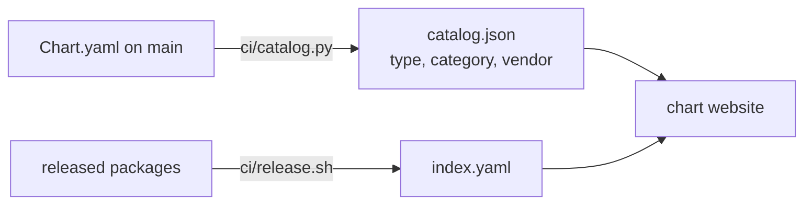

# Chart catalog annotations

Every chart names the category and the vendor of the software it installs in `Chart.yaml`.
The chart website at `apps.openshift.eu` filters on them and shows them on each card. They
change nothing in a release.



## Keys in Chart.yaml

| Key | Kind | Required | Value |
|---|---|---|---|
| `apps.openshift.eu/category` | annotation | yes, unless `mcp.openshift.eu/category` is set | One category in lowercase with hyphens, for example `collaboration`, `ai-agent`, `devops` |
| `apps.openshift.eu/vendor` | annotation | yes | The organisation or project behind the software, for example `Nextcloud GmbH` or `Apache Software Foundation`; not the chart publisher, which is `charts.openshift.io/provider` |

- An MCP server or bundle chart takes its category from `mcp.openshift.eu/category`
  ([MCP catalog labels](mcp-catalog.md)) and sets `apps.openshift.eu/category` only to
  override it. One list of categories serves applications and MCP charts.
- A chart this repository writes itself, with no upstream project, names its own publisher
  as the vendor.
- `ci/check.sh` fails when a chart has no vendor or no category, or a category that is not
  lowercase with hyphens.

## Type

The website shows a type on every card. It is derived, not set:

| Type | Chart |
|---|---|
| MCP server | Annotation `mcp.openshift.eu/server` or keyword `mcp-server` |
| MCP bundle | Name `mcp-bundle-<bundle>` or `mcp-all`, or keyword `mcp-bundle` |
| App | Every other chart |

## catalog.json

The release workflow runs `ci/publish-catalog.sh` on every push to `main` that touches
`charts/`. It writes `catalog.json` from the `Chart.yaml` files on `main` next to
`index.yaml` on the `gh-pages` branch:

```json
{"charts": {"mcp-gmail": {"type": "mcp-server", "category": "productivity",
  "vendor": "Google", "bundle": "google-workspace", "server": "gmail"}}}
```

- `index.yaml` holds only what a released package carries. `catalog.json` lets a changed
  category or vendor show on the website without a new chart version, so a change to these
  two annotations alone raises no chart `version`.
- The website lists the charts of `index.yaml` and takes type, category and vendor from
  `catalog.json`. A chart missing from `catalog.json` falls back to the annotations in
  `index.yaml`.
